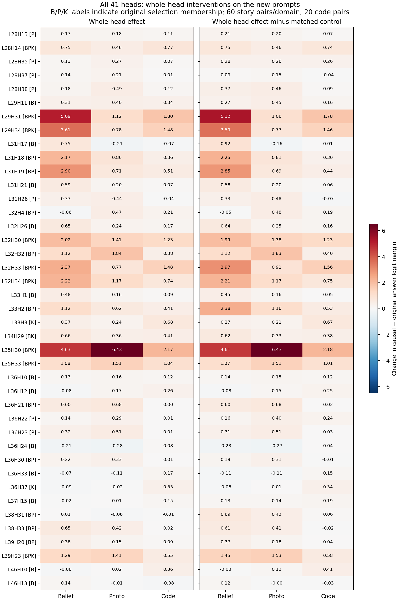

# Full path-patching run: analysis of union41_v2

> **Current connection analysis:** the eight H200 repair arms are now validated. See the [complete 14-cell, 41-head report](../path_patching_h200_analysis/REPORT.md). This report preserves the earlier analysis and its then-current limitations.

All 14 cells completed. Whole-head interventions reproduce the previous domain pattern closely. The direct-path results are smaller and require a numerical validation before they can explain that pattern mechanistically. No experimental code was changed and no new model runs were submitted during this analysis.

## What was checked

- 14 condition/template/direction cells, 10 prompt pairs each; 41 selected heads and 41 distinct same-layer controls in every cell.
- 280 complete checkpoints across the two receiver scopes; 621,040 path rows; 11,480 nonduplicated whole-head effects (82 heads × 140 pairs). Receiver rows are not independent samples.
- Pair contents, pair hashes, plan hashes, run-script hashes and saved dependency versions agree. All 11 source hashes match the frozen code snapshot. Native key/value groups are already deduplicated.
- The recorded sender self-patch, single-row receiver no-op, single-row frozen-writer self-path and replicated-batch-row controls all report zero error. This does not establish the missing batched clean-transplant control below.
- Every clean prompt prefers the original answer to the causal alternative (all 140 two-answer margins negative, maximum −2.75). Full-vocabulary accuracy and donor accuracy were not saved and are not inferred from this check.
- The 28 scope timings sum to 15,584.7 seconds of measured pair processing, about 4.33 hours across jobs. Per-cell processing ranges 10.3–42.7 minutes. These are measured processing sums, not elapsed wall-clock time for the parallel study, and exclude loading/setup/queue time.

Source: `results/circuit/path_patching/union41_v2/`. Job logs: `slurm_logs/path_union41_9923275_*.out/.err`. Executed source: `code_snapshot/scripts/circuit/path_patching.py`, protocol `frozen_writers_final_token_v3_batched`, Qwen2.5-14B-Instruct in bfloat16, batch size 8 plus an unpatched reference row. Historical July path-patching artifacts remain a separate, unrecovered experiment.

## Metric, comparisons and uncertainty

Every effect is a signed, unbounded change in `logit(causal answer) − logit(original answer)`. Positive moves toward the causal answer; zero means no measured change. It is not accuracy, flip probability, or a recovery percentage.

The ordinary whole-head intervention replaces one head's final-token output and lets later computation run normally. The path intervention transplants one specified receiver input after holding the other intermediate head/MLP writes fixed. Its effect is measured against an unpatched row in the same output batch. These are different interventions; separate path effects need not add to the whole-head effect.

The matched-control comparison subtracts the same-layer control's effect on the exact same prompt from the selected head's effect. Controls are real unselected heads, not necessarily inert: some have negative effects. A large target-minus-control value need not mean a large target effect. Only one fixed random control per head was sampled, so this is not a complete random-head null distribution.

For whole-head uncertainty, the null is equality of mean effects between domains (both raw effects and target-minus-control effects). We resample the 10 prompt rows jointly across all heads within each fixed cell, using 50,000 bootstrap draws, seed 20261022. Each cell uses a maximum standardized mean error across 123 series (41 targets, controls and paired differences), with alpha=0.05/14. Cell bounds are propagated through equal-weight domain averages and contrasts. This yields conservative **approximate** simultaneous bounds over the reported whole-head comparisons without requiring independence between cells. A zero observed variance is marked unavailable for uncertainty, not treated as certainty. Small samples make these exploratory bounds approximate; they do not establish generalization beyond the observed templates.

Belief/photo domain means equally weight their six cells (60 prompts each); code equally weights two cells (20 prompts). We do not assume that equal row numbers across domains are matched observations. No formal path significance tests were run, given the numerical issue and the many routes inspected. Selecting the strongest observed route is exploratory and upward-biased.

## Whole-head findings

Across the 41 selected heads, correlation with the previous causal mediation analysis (CMA) mean effects is **0.998 belief, 0.998 photo, 0.968 code**. Pearson correlation ranges −1 to +1; here it compares the relative effect sizes of the same 41 heads in each domain. This agreement is not independent proof of semantic specialization: these are selected heads, and overlap with historical prompt content has not been ruled out.

- **Four strict belief-only candidates retain larger belief averages:** L31H17 (0.747/−0.210/−0.069), L31H21 (0.589/0.201/0.069), L32H26 (0.653/0.240/0.169), L33H1 (0.476/0.164/0.088), in belief/photo/code order. None of their new-sample belief-minus-photo or belief-minus-code differences excludes zero under the conservative simultaneous bounds. These are consistent descriptive trends, not four confirmed belief-specific mechanisms.
- **The clearest domain differences also occur in shared heads.** L29H31 belief−photo = 3.968 [0.331, 7.606]; L29H34 = 2.829 [0.148, 5.510]. Both are selected in all three domains. L31H19, selected in belief and photo, has belief−photo = 2.189 [0.131, 4.247] and belief−code = 2.384 [0.142, 4.627]. These same four contrasts retain positive lower bounds after matched-control subtraction. No other raw domain contrasts exclude zero under this analysis's bounds; lack of exclusion does not establish equality.
- **Template/direction variation remains important.** L31H17's belief effect is 2.425 in food-truck ABA but −0.288 in library ABA. L31H21 is −0.225 in food-truck ABA but 1.506 in hair-styling ABA. L32H26 reverses sign across several cells. L33H1's largest belief effect is hair-styling ABA (1.369). Belief exceeds photo in 5/6, 4/6, 4/6 and 6/6 corresponding cells respectively.

### Every nonshared selection group

- **Remaining eight belief-only heads:** L29H11 has comparable positive effects across all three domains. L36H10 is small across all three. L36H12, L37H15 and L46H10 do not show a belief advantage in these means. L36H24 and L36H33 are negative in belief/photo and slightly positive in code. L46H13 has a small positive belief mean but an unresolved domain contrast. Their selection label does not establish a belief-specific operation; their existing answer/location-control evidence is not replaced by this divergence-only run.
- **All seven photo-only heads:** each has a higher photo mean than belief/code here, but no individual domain contrast clears the conservative bounds. L31H26 again has positive belief/photo effects and approximately zero code effect; it is not exclusively photo-responsive.
- **Both code-only heads:** L33H3 averages 0.374/0.238/0.681 and L36H37 −0.091/−0.017/0.331. Their code preference is driven mainly by the ABB direction: L33H3 code ABA/ABB = 0.150/1.213; L36H37 = −0.038/0.700. Do not describe this as direction-invariant code specialization.
- **Ten belief+photo-only heads:** L31H18/L31H19 favor belief in their averages; L32H4/L32H32 favor photo; L33H2 responds in both story domains; L36H21/L36H30 have larger story than code averages; L38H33/L39H20 favor belief in their averages. L38H31's own mean is near zero in every domain, while its control is negative—its positive control-adjusted contrast is not evidence of a large standalone effect.
- **The sole belief+code-only head, L34H29:** positive in all three domains (0.664/0.358/0.406), without a resolved domain difference.
- **All nine three-domain-shared heads:** positive whole-head averages in all three domains, with substantially different magnitudes. Shared membership therefore does not imply equal use across domains.

This run contains C1/C2/K1 divergence contrasts only. It does not newly disentangle veracity from location/index content; those claims still require the separately existing content/index-manipulation evidence.

## What the direct paths currently show

Ordinary whole-head effects can be large, while individual measured receiver paths are generally small. For shared L29H31, the belief whole-head mean is 5.093, whereas the largest observed mean among its tested individual belief paths is 0.0365. For L35H30, the photo whole-head mean is 6.426 versus 0.0646 for its largest observed individual photo path. These are **not recovery fractions**, and do not imply that the unmeasured remainder bypasses queries: joint paths, untested receivers, intermediate-writer-mediated routes and numerical precision remain unresolved.

The strongest positive domain-averaged candidate is **L39H23 → L43H30 query in code**:

| Domain | Target path mean | Matched-control path mean | Target − control |
|---|---:|---:|---:|
| Belief | 0.0375 | −0.0156 | 0.0531 |
| Photo | 0.0391 | 0.0391 | 0.0000 |
| Code | 0.2438 | −0.0188 | 0.2625 |

L39H23 is shared across all three domains; its matched control is L39H22. The code path is positive in 16/20 prompts, negative in one, and zero in three; means are 0.100 in ABA and 0.3875 in ABB. No batch-vs-single drift was observed in the code cells, making this a useful candidate to preserve. It is still selected after inspecting many paths and is not a confirmed domain-specific route. Full descriptive route tables retain every selected head and matched control, including the separate L47 search.

## Numerical issue: direct evidence and its limits

For `C1_hair_styling_ABB/existing_candidates/pair_000006.json`, **nine rows have receiver_delta_l2 exactly zero but path effects ±0.125**. All nine concern control head L36H34, which is paired with photo-only L36H23. In total, 32 measured route rows have zero receiver change; nine of those are nonzero at the output.

Example: L36H34 → L46H10 query, receiver change = 0, path effect = +0.125; clean single-row margin = −23.0, batch clean margin = −23.25. This is a concrete no-change counterexample, not merely a warning inferred from the dtype.

The executed code captures clean/donor-derived receiver activations in single-row passes, then transplants those cached vectors into batched passes. The clean receiver-transplant and frozen-writer self-path controls are evaluated only in single-row passes. Identical untouched batch rows do pass their equality check, but that does not test transplanting the single-row clean activation into a batch. The observed counterexample shows that this transition can produce an effect without any donor-induced receiver change.

Batch clean margins differ from single-row clean margins on 39/140 prompt pairs: C1 food-truck ABB (9), C1 hair-styling ABB (10), C2 food-truck ABA (10), C2 food-truck ABB (10). Maximum margin difference = 1.5. This difference is **not itself the residual path error**: the script already subtracts an in-batch clean reference. The counterexample isolates the remaining problem. It does not prove every path is wrong, nor does it provide a correction factor or an error bound for other rows. Whole-head effects are evaluated in single-row passes and do not use this mixed-batch transplant.

Before using the small paths to explain domain differences, validate a clean-receiver transplant **in the exact same batch layout and batch sizes as the actual path intervention**, including the final partial batch. That control should be zero. First establish the magnitude/scope of this issue; this report does not recommend blindly repeating the whole study or changing the experiment's scientific question. No fix or follow-up GPU experiment was implemented here.

## Complete 41-head table

Values are the domain means of the signed whole-head logit-margin effects defined above. Selection membership is historical membership, not a newly inferred function. Control columns subtract each head's fixed same-layer control; these are not ablations or probabilities.

| Head | Original selection | Belief | Photo | Code | Belief − control | Photo − control | Code − control |
|---|---|---:|---:|---:|---:|---:|---:|
| L28H13 | photo | 0.168 | 0.175 | 0.113 | 0.205 | 0.197 | 0.069 |
| L28H14 | belief + photo + code | 0.753 | 0.458 | 0.775 | 0.754 | 0.460 | 0.744 |
| L28H35 | photo | 0.132 | 0.269 | 0.069 | 0.282 | 0.264 | 0.256 |
| L28H37 | photo | 0.143 | 0.210 | 0.012 | 0.087 | 0.151 | -0.037 |
| L28H38 | photo | 0.183 | 0.490 | 0.119 | 0.373 | 0.462 | 0.087 |
| L29H11 | belief | 0.311 | 0.403 | 0.344 | 0.274 | 0.449 | 0.156 |
| L29H31 | belief + photo + code | 5.093 | 1.124 | 1.800 | 5.319 | 1.065 | 1.781 |
| L29H34 | belief + photo + code | 3.607 | 0.778 | 1.481 | 3.592 | 0.767 | 1.456 |
| L31H17 | belief | 0.747 | -0.210 | -0.069 | 0.921 | -0.159 | 0.013 |
| L31H18 | belief + photo | 2.170 | 0.859 | 0.362 | 2.247 | 0.807 | 0.300 |
| L31H19 | belief + photo | 2.897 | 0.708 | 0.512 | 2.853 | 0.692 | 0.444 |
| L31H21 | belief | 0.589 | 0.201 | 0.069 | 0.580 | 0.196 | 0.056 |
| L31H26 | photo | 0.332 | 0.442 | -0.044 | 0.325 | 0.478 | -0.069 |
| L32H4 | belief + photo | -0.055 | 0.472 | 0.212 | -0.048 | 0.482 | 0.194 |
| L32H26 | belief | 0.653 | 0.240 | 0.169 | 0.642 | 0.247 | 0.163 |
| L32H30 | belief + photo + code | 2.018 | 1.408 | 1.225 | 1.992 | 1.384 | 1.225 |
| L32H32 | belief + photo | 1.124 | 1.844 | 0.381 | 1.124 | 1.833 | 0.400 |
| L32H33 | belief + photo + code | 2.373 | 0.766 | 1.481 | 2.970 | 0.908 | 1.562 |
| L32H34 | belief + photo + code | 2.216 | 1.172 | 0.744 | 2.206 | 1.167 | 0.750 |
| L33H1 | belief | 0.476 | 0.164 | 0.087 | 0.448 | 0.157 | 0.050 |
| L33H2 | belief + photo | 1.118 | 0.619 | 0.412 | 2.384 | 1.155 | 0.525 |
| L33H3 | code | 0.374 | 0.237 | 0.681 | 0.270 | 0.211 | 0.669 |
| L34H29 | belief + code | 0.664 | 0.358 | 0.406 | 0.623 | 0.330 | 0.381 |
| L35H30 | belief + photo + code | 4.634 | 6.426 | 2.175 | 4.607 | 6.431 | 2.181 |
| L35H33 | belief + photo + code | 1.084 | 1.507 | 1.044 | 1.073 | 1.513 | 1.012 |
| L36H10 | belief | 0.130 | 0.161 | 0.125 | 0.139 | 0.153 | 0.119 |
| L36H12 | belief | -0.077 | 0.168 | 0.256 | -0.080 | 0.151 | 0.250 |
| L36H21 | belief + photo | 0.599 | 0.685 | 0.000 | 0.603 | 0.684 | 0.019 |
| L36H22 | photo | 0.141 | 0.286 | 0.013 | 0.158 | 0.397 | 0.237 |
| L36H23 | photo | 0.318 | 0.511 | 0.006 | 0.308 | 0.506 | 0.025 |
| L36H24 | belief | -0.209 | -0.280 | 0.075 | -0.230 | -0.274 | 0.037 |
| L36H30 | belief + photo | 0.216 | 0.332 | 0.006 | 0.190 | 0.310 | -0.012 |
| L36H33 | belief | -0.075 | -0.115 | 0.175 | -0.115 | -0.108 | 0.150 |
| L36H37 | code | -0.091 | -0.017 | 0.331 | -0.077 | 0.006 | 0.344 |
| L37H15 | belief | -0.021 | 0.013 | 0.150 | 0.129 | 0.142 | 0.188 |
| L38H31 | belief + photo | 0.006 | -0.065 | -0.006 | 0.685 | 0.421 | 0.056 |
| L38H33 | belief + photo | 0.647 | 0.424 | 0.025 | 0.605 | 0.408 | -0.019 |
| L39H20 | belief + photo | 0.378 | 0.153 | 0.087 | 0.372 | 0.176 | 0.044 |
| L39H23 | belief + photo + code | 1.286 | 1.411 | 0.550 | 1.449 | 1.527 | 0.581 |
| L46H10 | belief | -0.081 | 0.023 | 0.362 | -0.029 | 0.129 | 0.412 |
| L46H13 | belief | 0.137 | -0.014 | -0.075 | 0.122 | -0.001 | -0.031 |



## Files and reproduction

- `audit.json`: 280 checkpoint hashes, source checks, bootstrap settings and numerical audit counts.
- `all_41_heads.csv`: all heads, controls, means and conservative approximate domain bounds.
- `whole_sender_per_prompt.csv`, `whole_sender_cell_bounds.csv`, `whole_sender_domain_bounds.csv`, `whole_sender_domain_contrasts.csv`: individual prompt effects and comparisons.
- `path_cell_descriptive.csv`, `path_domain_descriptive.csv`, `path_target_control_descriptive.csv`: every measured route, with native K/V group IDs labeled `KV` rather than head IDs. Group indices are zero-based and affect multiple query heads.
- `strongest_observed_routes_NOT_confirmed.csv`: selected maxima, explicitly exploratory.
- `coverage_and_numerics.csv`, `clean_margin_diagnostics.csv`, `zero_change_nonzero_path.csv`: completion and numerical diagnostics.
- `comparison_to_previous_cma.csv`: descriptive correspondence with earlier CMA head profiles.

Run from the repository root with `.venv` activated:

```bash
OPENBLAS_NUM_THREADS=1 VECLIB_MAXIMUM_THREADS=1 python results/aggregated/path_patching_analysis/analyze.py
```

The script reads saved JSON and previous CMA summaries, writes only this analysis directory, and does not load a model or modify experimental outputs.
