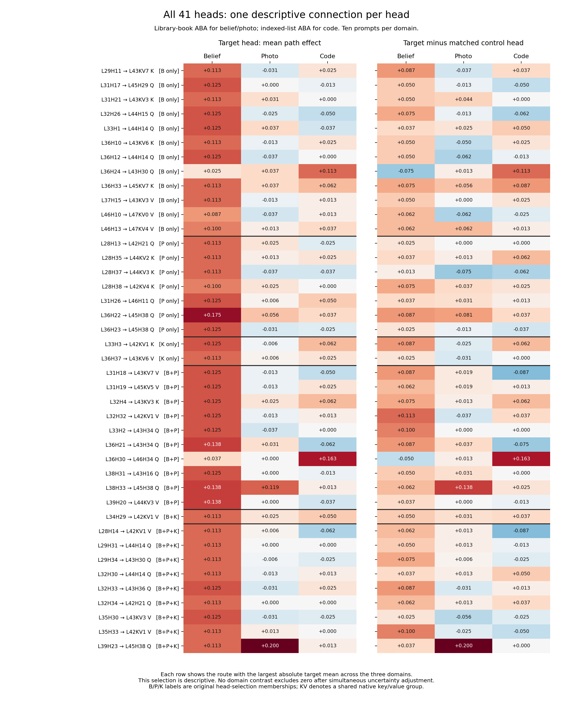

# Clean-transplant audit and all-41-head connection analysis

> **Current connection analysis:** the eight H200 repair arms are now validated. See the [complete 14-cell, 41-head report](../path_patching_h200_analysis/REPORT.md). This report preserves the earlier analysis and its then-current limitations.

**The follow-up is complete, but it does not validate the full original grid.** All 280 control checkpoints are present and their links to the original data pass hash, pair, route and batch-layout checks. The main restriction is GPU-dependent numerical behavior and different GPU assignments between runs.

## What the controls establish

- 15,400 distinct clean-control measurements map to all 621,040 original path rows. No source results were changed; no control effect was subtracted from a path effect.
- All 11,000 H200 controls passed exactly (zero full-logit error). All 4,400 L40S controls failed the `1e-4` full-logit tolerance. Of those, 1,152 also changed the answer margin; the largest absolute change was 0.4375. Thus failure is not limited to irrelevant vocabulary logits.
- Clean versus frozen-clean single-row caches agree, frozen-clean logits agree, untouched batched rows agree, and row-zero references agree in all cells. The failure appears when the single-row receiver activation is transplanted into a batched run. GPU type is perfectly associated with failure in this follow-up, but prompts and hardware were not crossed experimentally, so this is not an isolated hardware-causation test.
- The launcher allowed mixed GPU partitions. Four original H200 cells received L40S controls; four original non-H200-node cells received H200 controls. This design oversight leaves eight cells without compatible control evidence. A passing control on a different GPU does not retroactively repair a contaminated original measurement.
- Six cells have passing controls, the same H200 GPU family, and exactly matching saved single-row and batched answer margins. This is compatibility evidence from the saved diagnostics, not proof of exact equality of every old/new internal activation.

| Cell | Original node | Control GPU | Failed / 1100 | Prompts with single-margin drift | Prompts with batch-margin drift | Compatible |
|---|---|---|---:|---:|---:|---|
| C1_food_truck_ABA | h200b | H200 NVL | 0 | 0 | 0 | yes |
| C1_food_truck_ABB | l40sx8 | H200 NVL | 0 | 10 | 9 | no |
| C1_hair_styling_ABA | h200b | L40S | 1100 | 8 | 10 | no |
| C1_hair_styling_ABB | l40sx8 | H200 NVL | 0 | 9 | 10 | no |
| C1_library_book_ABA | h200b | H200 NVL | 0 | 0 | 0 | yes |
| C1_library_book_ABB | h200b | L40S | 1100 | 9 | 10 | no |
| C2_food_truck_ABA | a01 | H200 NVL | 0 | 8 | 10 | no |
| C2_food_truck_ABB | a01 | H200 NVL | 0 | 7 | 10 | no |
| C2_hair_styling_ABA | h200b | L40S | 1100 | 8 | 10 | no |
| C2_hair_styling_ABB | h200b | H200 NVL | 0 | 0 | 0 | yes |
| C2_library_book_ABA | h200b | H200 NVL | 0 | 0 | 0 | yes |
| C2_library_book_ABB | h200b | H200 NVL | 0 | 0 | 0 | yes |
| K1_indexed_list_ABA | h200b | H200 NVL | 0 | 0 | 0 | yes |
| K1_indexed_list_ABB | h200b | L40S | 1100 | 7 | 9 | no |

The nine original zero-receiver-change/nonzero-output counterexamples were on the old L40S run of belief hair-styling ABB. Their new H200 controls are zero; that hardware mismatch prevents using the new zeros to dismiss the original counterexamples. The GPU model of original `a01` jobs is not explicitly recorded in the inspected launcher lines, so it is left unidentified.

## Comparison and statistical scope

Each connection is a sender head, later receiver, and one of query (Q), key (K), or value (V). There are **2,218 selected-head connections**: 39 senders × 54 distinct native receiver components, plus two layer-46 senders × 56 exploratory layer-47 components. Each has a fixed same-layer control sender. Native K/V groups are counted once; aliases are retained.

**Metric:** path effect = transplanted-run `[logit(causal answer) − logit(original answer)]` minus the untouched reference row’s same margin. It is signed and unbounded, measured in logit units; positive favors the designated causal answer. It is not an accuracy percentage. **Matched-control comparison:** target path effect minus the control sender’s effect on the identical receiver/component for the identical prompt. The clean-transplant control tests an unintended numerical effect; the matched head tests whether the selected sender has a larger effect than that particular unselected head. One control head does not represent a distribution of random heads.

For a three-domain comparison with the same story template and direction, the usable overlap is **C1 library-book ABA, C2 library-book ABA, K1 indexed-list ABA**, ten prompts each. ABA is the original donor/recipient direction label; the saved runner transplants donor into recipient. Code necessarily has a different template. We do not pool unmatched template/direction mixtures and call their difference a domain effect. The other three compatible cells are tested separately as within-cell evidence.

Within each of the six compatible cells, the project’s existing `permutation_test_heads` tests all 2,218 target series and 2,218 target-minus-control series jointly with 5,000 sign permutations and a maximum absolute mean statistic. Bonferroni correction covers the six cells (overall alpha 0.05). The null requires joint sign symmetry of prompt-level effects around zero; this assumption is not guaranteed by a randomized domain assignment. Exhaustive enumeration of all 1,024 sign assignments independently confirms every detection decision. Reported exact p values include the maximum-statistic and six-cell corrections.

Domain differences are tested directly through simultaneous uncertainty intervals, rather than comparing which domains passed a detection threshold. We resample ten prompt rows jointly within each cell (50,000 bootstrap samples), preserve dependence between paths and matched controls, use the maximum standardized mean error across all paths/comparisons, and allocate alpha 0.05 across the six cells. Difference bounds are formed by subtracting endpoint bounds, requiring no pairing or independence between domains. These are conservative, approximate bootstrap intervals with only ten prompts, not exact small-sample guarantees. Zero observed variance is marked unestimated rather than assigned certainty. They describe the fixed tested templates/directions; they do not cover a population of possible templates.

## Findings

**One connection survives the corrected within-cell test:** shared sender **L39H23 → L45H38 Q**, in photo library-book ABA. Target mean = +0.200; matched-control mean = 0; target-minus-control mean = +0.200. Eight of ten target effects are positive, two zero. Exact corrected p = 0.046875 for both target and target-minus-control. This remains conditional evidence in one cell, not a photo-specific mechanism.

For that same connection in the common three-domain comparison:

| Quantity | Belief | Photo | Code |
|---|---:|---:|---:|
| Target mean | +0.1125 | +0.2000 | +0.0125 |
| Matched-control mean | +0.0750 | 0.0000 | +0.0125 |
| Target minus control | +0.0375 | +0.2000 | 0.0000 |

**No direct domain contrast excludes zero under the simultaneous intervals.** Bounds are finite for 12,634 of 13,308 contrasts; the other 674 are unestimated because at least one component has zero empirical variance. No route has positive corrected detections in all three domains. Neither result establishes that shared paths are absent or that domain effects are equal. The shared-versus-domain-specific connection ratio is therefore not established. Merely counting positive means gives 350 routes positive in all three domains (178 after control subtraction), but those are descriptive signs, not established shared connections.

**Other compatible photo cells show template/direction dependence descriptively:** L39H23 → L45H38 Q is +0.275 in library-book ABB (control −0.0375), but −0.03125 in hair-styling ABB (control +0.03125). Neither additional cell passes the full-set corrected test. The ABA photo result should not be generalized to every photo template.

**The earlier code candidate needs downgrading:** L39H23 → L43H30 Q is +0.100 in the compatible code ABA cell, versus +0.1125 in belief and −0.025 in photo. After matched-control subtraction, belief and code are both +0.075 and photo is zero. Its much larger code ABB mean (+0.3875) comes from a cell whose follow-up control ran on L40S and failed. The previously reported pooled code advantage is still provisional.

**All non-shared heads were included.** The 12 strict belief-only heads (including the four earlier whole-head candidates L31H17, L31H21, L32H26, L33H1), seven photo-only heads, two code-only heads, ten belief+photo heads and one belief+code head have no connection surviving this full-set within-cell correction. The same is true for eight of nine three-domain-shared senders; L39H23 is the exception above. This does not overturn their whole-head causal effects or prove that they lack downstream influence. The assay isolates final-token direct routes to the chosen receivers, excluding influence mediated through changing intermediate writers and other token positions.

| Original head membership | Heads | Connections tested | Connections detected in any compatible cell |
|---|---:|---:|---:|
| belief | 12 | 652 | 0 |
| photo | 7 | 378 | 0 |
| code | 2 | 108 | 0 |
| belief + photo | 10 | 540 | 0 |
| belief + code | 1 | 54 | 0 |
| belief + photo + code | 9 | 486 | 1 |

## Complete head-by-head descriptive table

One connection per head is shown below, chosen by the largest absolute **target** mean across the common three-domain subset; ties use saved route order. This is a descriptive selection, not a confirmed best path. Selecting maxima with the same data favors noisy, high-variance domains; the mostly red belief column in the figure is not evidence of belief specialization. All 2,218 connections, including negative effects, native-group aliases and both statistical comparisons, are saved in the linked tables. Values below are target means; corresponding control means and differences are in the all-head CSV and figure.

| Head | Original membership | Selected observed receiver/component | Belief | Photo | Code |
|---|---|---|---:|---:|---:|
| L29H11 | belief | L43KV7 K | +0.1125 | -0.0312 | +0.0250 |
| L31H17 | belief | L45H29 Q | +0.1250 | +0.0000 | -0.0125 |
| L31H21 | belief | L43KV3 K | +0.1125 | +0.0312 | +0.0000 |
| L32H26 | belief | L44H15 Q | +0.1250 | -0.0250 | -0.0500 |
| L33H1 | belief | L44H14 Q | +0.1250 | +0.0375 | -0.0375 |
| L36H10 | belief | L43KV6 K | +0.1125 | -0.0125 | +0.0250 |
| L36H12 | belief | L44H14 Q | +0.1250 | -0.0375 | +0.0000 |
| L36H24 | belief | L43H30 Q | +0.0250 | +0.0375 | +0.1125 |
| L36H33 | belief | L45KV7 K | +0.1125 | +0.0375 | +0.0625 |
| L37H15 | belief | L43KV3 V | +0.1125 | -0.0125 | +0.0125 |
| L46H10 | belief | L47KV0 V | +0.0875 | -0.0375 | +0.0125 |
| L46H13 | belief | L47KV4 V | +0.1000 | +0.0125 | +0.0375 |
| L28H13 | photo | L42H21 Q | +0.1125 | +0.0250 | -0.0250 |
| L28H35 | photo | L44KV2 K | +0.1125 | +0.0125 | +0.0250 |
| L28H37 | photo | L44KV3 K | +0.1125 | -0.0375 | -0.0375 |
| L28H38 | photo | L42KV4 K | +0.1000 | +0.0250 | +0.0000 |
| L31H26 | photo | L46H11 Q | +0.1250 | +0.0063 | +0.0500 |
| L36H22 | photo | L45H38 Q | +0.1750 | +0.0563 | +0.0375 |
| L36H23 | photo | L45H38 Q | +0.1250 | -0.0312 | -0.0250 |
| L33H3 | code | L42KV1 K | +0.1250 | -0.0063 | +0.0625 |
| L36H37 | code | L43KV6 V | +0.1125 | +0.0063 | +0.0250 |
| L31H18 | belief + photo | L43KV7 V | +0.1250 | -0.0125 | -0.0500 |
| L31H19 | belief + photo | L45KV5 V | +0.1250 | -0.0125 | +0.0250 |
| L32H4 | belief + photo | L43KV3 K | +0.1250 | +0.0250 | +0.0625 |
| L32H32 | belief + photo | L42KV1 V | +0.1250 | -0.0125 | +0.0125 |
| L33H2 | belief + photo | L43H34 Q | +0.1250 | -0.0375 | +0.0000 |
| L36H21 | belief + photo | L43H34 Q | +0.1375 | +0.0312 | -0.0625 |
| L36H30 | belief + photo | L46H34 Q | +0.0375 | +0.0000 | +0.1625 |
| L38H31 | belief + photo | L43H16 Q | +0.1250 | +0.0000 | -0.0125 |
| L38H33 | belief + photo | L45H38 Q | +0.1375 | +0.1187 | +0.0125 |
| L39H20 | belief + photo | L44KV3 V | +0.1375 | +0.0000 | -0.0375 |
| L34H29 | belief + code | L42KV1 V | +0.1125 | +0.0250 | +0.0500 |
| L28H14 | belief + photo + code | L42KV1 V | +0.1125 | +0.0063 | -0.0625 |
| L29H31 | belief + photo + code | L44H14 Q | +0.1125 | +0.0000 | +0.0000 |
| L29H34 | belief + photo + code | L43H30 Q | +0.1125 | -0.0063 | -0.0250 |
| L32H30 | belief + photo + code | L44H14 Q | +0.1125 | -0.0125 | +0.0125 |
| L32H33 | belief + photo + code | L43H36 Q | +0.1250 | -0.0312 | +0.0250 |
| L32H34 | belief + photo + code | L42H21 Q | +0.1125 | +0.0000 | +0.0000 |
| L35H30 | belief + photo + code | L43KV3 V | +0.1250 | -0.0312 | -0.0250 |
| L35H33 | belief + photo + code | L42KV1 V | +0.1125 | +0.0125 | +0.0000 |
| L39H23 | belief + photo + code | L45H38 Q | +0.1125 | +0.2000 | +0.0125 |

## What remains to complete the intended grid

The smallest repair supported by this audit is to align the missing arms on H200, with unchanged prompts, model revision, dtype, batch layouts and separate output roots. This is a recommendation only; no launcher was changed and no new jobs were submitted.

- **Repeat only the clean controls** for tasks **2, 5, 8, 13**: belief hair-styling ABA; belief library-book ABB; photo hair-styling ABA; code ABB. Their original path runs were already on H200.
- **Repeat the original path measurements on H200** for tasks **1, 3, 6, 7**: belief food-truck ABB and hair-styling ABB; photo food-truck ABA and ABB. Their H200 clean controls already exist. Recheck clean margins and provenance against those controls when the new path data arrive.
- Retain the six currently compatible cells. If additional failures remain under matched hardware, diagnose those failures before making path-specific claims. Do not use a nonzero clean control as an additive correction factor.

## Files and reproduction

- [All 41 heads](all_41_heads_restricted.csv): complete head table and control comparisons.
- [All 2,218 connections in the common subset](all_connections_restricted.csv).
- [Every compatible cell’s estimates and tests](all_compatible_cell_estimates.csv).
- [Direct domain contrasts](restricted_domain_differences.csv): raw and matched-control comparisons, including unestimated bounds.
- [Full original-grid means — provisional](full_grid_connection_means_PROVISIONAL.csv): all original cells retained, explicitly not validated by this follow-up.
- [Every original cell’s means](all_connection_cell_means.csv), [control audit](control_audit_by_cell.csv), [individual clean controls](clean_controls.csv).
- [Original no-change counterexamples](original_zero_change_counterexamples.csv), [hashes/settings](audit.json).
- Reproduce from the project root with `.venv/bin/python results/aggregated/path_patching_clean_analysis/analyze.py`, then `.venv/bin/python results/aggregated/path_patching_clean_analysis/render_report.py`. These scripts read saved results only; they do not run the model or mutate the original experiments.
