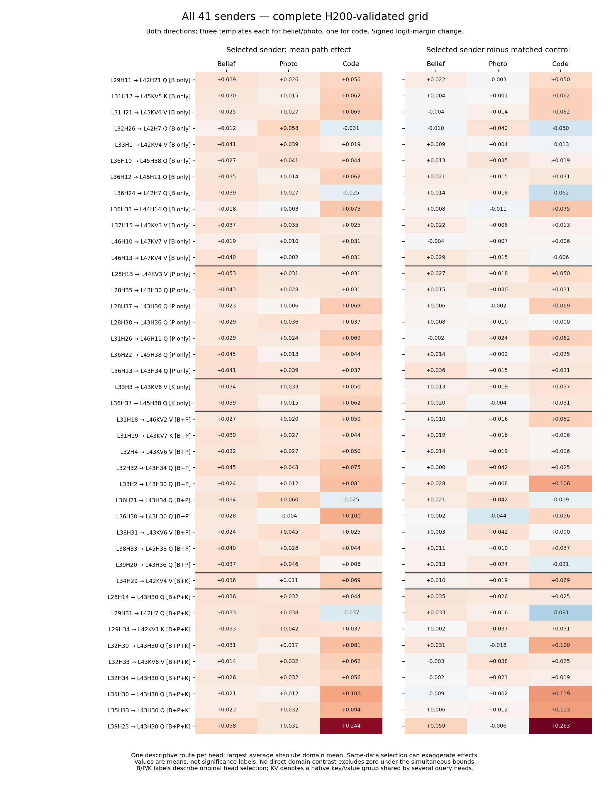

# H200 repairs: complete 41-head connection analysis

Updated October 23, 2026. **All eight repair arms pass; all 14 combined cells are now numerically compatible.** This report supersedes the six-cell clean-control analysis for the full-grid connection comparison. Original and repaired raw studies are preserved separately.

**Interpretation update:** the [sample-size, effect-size and statistical-method diagnostic](diagnostics/REPORT.md) shows that the ten-prompt/full-family exact test rules out detection for any series containing a zero, and that the domain intervals are conservative by construction. Non-detections here must not be read as precise evidence against shared or domain-specific mechanisms. The diagnostic also separates broader whole-head/residual-steering causal evidence from the narrower path result.

## Repair validation

- All eight repairs have 20 scope/prompt checkpoints each and record NVIDIA H200 NVL on `h200b`, with the original Torch 2.5.1+cu121, TransformerLens 2.16.1, and Transformers 4.53.2 versions. Snapshot, prompt, task and source hashes pass. Per-task Slurm job IDs can differ from the parent array ID and are retained in `repair_runtime.json`.
- The four rerun clean-control cells contribute 4,400 controls, all with exactly zero full-logit error. Together with retained H200 controls, all 15,400 clean transplants pass, with zero error in the checked diagnostics.
- For the four repaired path cells, retained controls still truthfully reference the old path-file hashes. The analysis verifies those old references, then matches exact prompt, sender, receiver component, route aliases, batch width and batch row to the repaired measurements. Selected path and control single/batch margins match exactly in all 14 cells.
- All 621,040 selected/control-sender path rows pass the saved identity diagnostics. No selected measurement has zero receiver change with a nonzero path effect. This removes the observed numerical failure; it is not a proof about unsaved internal activations.
- All 918 source files hashed by the audit were independently rechecked after analysis. Original raw outputs were not edited.

| Repaired arm | Cell | Clean controls | Failed | Baseline mismatches | Status |
|---|---|---:|---:|---:|---|
| Path | C1_food_truck_ABB | 1100 | 0 | 0 | PASS |
| Clean control | C1_hair_styling_ABA | 1100 | 0 | 0 | PASS |
| Path | C1_hair_styling_ABB | 1100 | 0 | 0 | PASS |
| Clean control | C1_library_book_ABB | 1100 | 0 | 0 | PASS |
| Path | C2_food_truck_ABA | 1100 | 0 | 0 | PASS |
| Path | C2_food_truck_ABB | 1100 | 0 | 0 | PASS |
| Clean control | C2_hair_styling_ABA | 1100 | 0 | 0 | PASS |
| Clean control | K1_indexed_list_ABB | 1100 | 0 | 0 | PASS |

The repaired path values genuinely replace the affected original values; they are not assumed to be equal. Per-prompt changes are saved in `old_vs_repaired_path_changes.csv`.

## What is measured and compared

**Path effect** is the transplanted-run answer margin, `logit(causal answer) − logit(original answer)`, minus the same margin in the untouched batch reference row. It is signed, unbounded and measured in logit units. Positive means movement toward the designated causal answer; it is not an accuracy percentage. **Target minus matched control** subtracts the effect of a fixed unselected sender from the same layer, acting on the identical receiver/component and prompt. That comparison is against one particular control head, not a population of random heads. The zero clean-transplant diagnostic is a different control; its value is never subtracted as a numerical correction.

The 41 selected divergence heads contribute **2,218 distinct connections**: 39 senders × 54 receiver components, plus two layer-46 senders × 56 exploratory layer-47 components. Query (Q) routes are per query head; key (K) and value (V) routes address native shared groups, counted once with aliases preserved. Each selected route has a same-layer control sender. The assay measures final-token direct routes with intermediate attention/MLP writes frozen; it does not cover all possible receivers, other token positions, or indirect routes through changing intermediate writers.

Each of 14 cells has 10 saved prompts. Full-grid means give equal weight to the six belief cells, six photo cells and two code cells within each domain. Belief/photo use the same three template labels and two transplant directions; code uses indexed-list in both directions. These are **fixed tested-task averages**, not general population effects. Direction-specific and each-story-template-versus-code tables are also supplied. Shared generation seeds and semantic content can induce cross-cell dependence; row numbers are not asserted to be matched statistical pairs.

## Inference and limits

1. **Within-cell tests:** null mean path effect = 0, or mean selected-minus-control effect = 0. Enumerate all 1,024 prompt-level sign assignments. The maximum absolute mean across 2,218 raw and 2,218 control-adjusted series controls the route/comparison search within a cell; multiply by 14 for all cells, at overall alpha 0.05. Exactness requires joint sign symmetry under the null, which is an assumption, not a randomized treatment assignment. All positive and negative effects enter the test.
2. **Domain contrasts:** null difference between the specified fixed-domain averages = 0. Jointly resample the 10 prompt rows within each cell 50,000 times. Maximum standardized centered-bootstrap errors provide simultaneous bounds across all 4,436 columns, with alpha allocated across 14 cells. Average cell endpoints for domain bounds, then subtract endpoints for contrasts. This remains conservative without assuming cross-cell independence or prompt pairing. The bootstrap coverage is approximate with n=10, not an exact small-sample guarantee. These interval calculations are not inversions of the unstudentized sign test, so their decisions can differ.
3. **Zero observed variance:** an empirical constant is assigned unestimated bounds, not certainty. Missing bounds propagate into averages and contrasts. In the full-grid comparison, 9,143 of 13,308 raw/control-adjusted contrasts have finite bounds; 4,165 are unestimated. No finite contrast excludes zero. The same conclusion holds for the direction and template breakdowns.
4. A **shared positive connection** requires positive support in all three domains; positive means alone are descriptive. **Domain preference** requires a direct domain contrast, not significance in one domain and non-significance in another. Even a significant preference would not prove exclusive use in one domain. These data establish neither a shared-route count nor an exclusive-route count.

## Findings

**L39H23 → L43H30 Q is the clearest remaining candidate, with a corrected selected-versus-control effect in code ABB.** The selected effect is +0.3875, the matched control is −0.0625, and their difference is +0.4500; all 10 prompt differences are positive. Exact full-study corrected p = 0.02734375. The raw effect alone does not pass that exact test (p = 0.1640625). The numerically invalid code control has now been repaired, so this comparison is usable.

Averaging both code directions gives selected effect +0.24375 and selected-minus-control +0.26250. The latter has a borderline positive approximate simultaneous interval [+0.00152, +0.52348]; the raw interval includes zero. Neither direct code-minus-belief nor code-minus-photo contrast excludes zero. Thus this supports a **code-cell contribution relative to its matched control**, not a code-specific mechanism.

**The earlier photo candidate, L39H23 → L45H38 Q, remains descriptively stronger in photo.** Its library-book ABA effect is unchanged at +0.2000, with control 0. The old six-cell correction gave p = 0.046875; testing the complete 14-cell family gives p = 0.109375. This change comes from the larger multiple-testing family, not a reversal of the measurement. Its approximate bootstrap interval in that cell is positive, while the primary exact sign test does not pass. Photo effects also vary by template/direction.

Full-grid means below are **selected effect (selected minus matched control)**. Each row is the same sender/receiver/component across all domains; positive values do not certify sharing or preference.

| Connection | Belief | Photo | Code |
|---|---:|---:|---:|
| L39H23 → L43H30 Q | +0.0583 (+0.0594) | +0.0307 (-0.0063) | +0.2437 (+0.2625) |
| L39H23 → L45H38 Q | +0.0542 (+0.0281) | +0.0984 (+0.0896) | +0.0250 (+0.0063) |

**No corrected route detection from any of the 32 non-shared sender heads.** All 12 belief-only, seven photo-only, two code-only, ten belief+photo, and one belief+code sender are included. None has a connection passing the full-set within-cell exact test; neither do eight of the nine shared senders. This does not contradict their whole-head causal effects: this narrower assay measures a specific direct route, and small effects, quantized outputs, ten prompts/cell, and broad multiplicity limit resolution. It does not establish that beliefs are processed identically or differently.

| Original selection membership | Heads | Connections | Connections with any corrected cell detection |
|---|---:|---:|---:|
| belief | 12 | 652 | 0 |
| photo | 7 | 378 | 0 |
| code | 2 | 108 | 0 |
| belief + photo | 10 | 540 | 0 |
| belief + code | 1 | 54 | 0 |
| belief + photo + code | 9 | 486 | 1 |

**Shared-versus-specific ratio: still not established.** No connection has supported positive effects in all three domains under both raw and matched-control comparisons, and no direct domain contrast is resolved. This is insufficient evidence, not a ratio of zero shared to zero specific. Descriptively, 1,275/2,218 routes (57.5%) have positive raw means in all three domains, falling to 283/2,218 (12.8%) after matched-control subtraction. These sign counts must not be presented as established shared circuits. Original head-selection membership (9 shared, 32 non-shared) is a separate quantity.

## Every sender

The table and figure show one descriptive route per head, selected by the largest average absolute domain mean, weighting the three domains equally. Selecting on these data exaggerates apparent extrema; this is not an inferential selection of a best route. Complete unfiltered results for all routes, controls, signs and native-group aliases are in `all_connections.csv`, `cell_estimates.csv`, and `domain_estimates.csv`.

| Sender | Original membership | Descriptive route | Belief | Photo | Code |
|---|---|---|---:|---:|---:|
| L29H11 | belief | L42H21 Q | +0.0385 | +0.0255 | +0.0563 |
| L31H17 | belief | L45KV5 K | +0.0302 | +0.0146 | +0.0625 |
| L31H21 | belief | L43KV6 V | +0.0250 | +0.0271 | +0.0688 |
| L32H26 | belief | L42H7 Q | +0.0125 | +0.0583 | -0.0312 |
| L33H1 | belief | L42KV4 V | +0.0406 | +0.0385 | +0.0187 |
| L36H10 | belief | L45H38 Q | +0.0271 | +0.0406 | +0.0437 |
| L36H12 | belief | L46H11 Q | +0.0354 | +0.0141 | +0.0625 |
| L36H24 | belief | L42H7 Q | +0.0385 | +0.0266 | -0.0250 |
| L36H33 | belief | L44H14 Q | +0.0177 | +0.0026 | +0.0750 |
| L37H15 | belief | L43KV3 V | +0.0375 | +0.0349 | +0.0250 |
| L46H10 | belief | L47KV7 V | +0.0187 | +0.0099 | +0.0312 |
| L46H13 | belief | L47KV4 V | +0.0396 | +0.0021 | +0.0312 |
| L28H13 | photo | L44KV3 V | +0.0531 | +0.0312 | +0.0312 |
| L28H35 | photo | L43H30 Q | +0.0427 | +0.0281 | +0.0312 |
| L28H37 | photo | L43H36 Q | +0.0229 | +0.0062 | +0.0688 |
| L28H38 | photo | L43H36 Q | +0.0292 | +0.0359 | +0.0375 |
| L31H26 | photo | L46H11 Q | +0.0292 | +0.0240 | +0.0688 |
| L36H22 | photo | L45H38 Q | +0.0448 | +0.0125 | +0.0437 |
| L36H23 | photo | L43H34 Q | +0.0406 | +0.0385 | +0.0375 |
| L33H3 | code | L43KV6 V | +0.0344 | +0.0333 | +0.0500 |
| L36H37 | code | L45H38 Q | +0.0385 | +0.0151 | +0.0625 |
| L31H18 | belief + photo | L46KV2 V | +0.0271 | +0.0198 | +0.0500 |
| L31H19 | belief + photo | L43KV7 K | +0.0385 | +0.0266 | +0.0437 |
| L32H4 | belief + photo | L43KV6 V | +0.0323 | +0.0271 | +0.0500 |
| L32H32 | belief + photo | L43H34 Q | +0.0448 | +0.0432 | +0.0750 |
| L33H2 | belief + photo | L43H30 Q | +0.0240 | +0.0125 | +0.0813 |
| L36H21 | belief + photo | L43H34 Q | +0.0344 | +0.0604 | -0.0250 |
| L36H30 | belief + photo | L43H30 Q | +0.0281 | -0.0036 | +0.1000 |
| L38H31 | belief + photo | L43KV6 V | +0.0240 | +0.0453 | +0.0250 |
| L38H33 | belief + photo | L45H38 Q | +0.0396 | +0.0276 | +0.0437 |
| L39H20 | belief + photo | L43H36 Q | +0.0375 | +0.0464 | +0.0063 |
| L34H29 | belief + code | L42KV4 V | +0.0365 | +0.0115 | +0.0688 |
| L28H14 | belief + photo + code | L43H30 Q | +0.0365 | +0.0318 | +0.0437 |
| L29H31 | belief + photo + code | L42H7 Q | +0.0333 | +0.0380 | -0.0375 |
| L29H34 | belief + photo + code | L42KV1 K | +0.0333 | +0.0417 | +0.0375 |
| L32H30 | belief + photo + code | L43H30 Q | +0.0312 | +0.0167 | +0.0813 |
| L32H33 | belief + photo + code | L43KV6 V | +0.0135 | +0.0318 | +0.0625 |
| L32H34 | belief + photo + code | L43H30 Q | +0.0260 | +0.0318 | +0.0562 |
| L35H30 | belief + photo + code | L43H30 Q | +0.0208 | +0.0120 | +0.1062 |
| L35H33 | belief + photo + code | L43H30 Q | +0.0229 | +0.0323 | +0.0938 |
| L39H23 | belief + photo + code | L43H30 Q | +0.0583 | +0.0307 | +0.2437 |



## Files and reproduction

- [All 41 heads](all_41_heads.csv) and [all 2,218 connections](all_connections.csv).
- [All cell estimates and exact tests](cell_estimates.csv); [fixed-grid domain estimates](domain_estimates.csv); [direct domain contrasts](domain_differences.csv).
- [Repair/retained-cell audit](control_audit_by_cell.csv), [individual clean controls](clean_controls.csv), [source hashes](audit.json), [statistical settings](statistics.json).
- [Validated source selection](validated_sources.json) identifies exactly which original and repaired roots were combined.

Run from the repository root in the activated project environment:
```bash
python results/aggregated/path_patching_h200_analysis/audit_repairs.py
python results/aggregated/path_patching_h200_analysis/analyze.py
python results/aggregated/path_patching_h200_analysis/verify_analysis.py
python results/aggregated/path_patching_h200_analysis/render_report.py
```
These scripts read saved experiment outputs and write only analysis artifacts. No new GPU experiment was launched.
